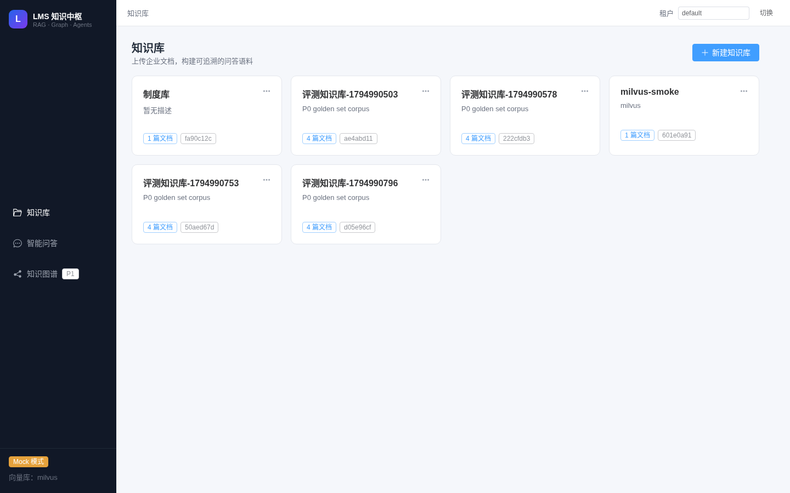
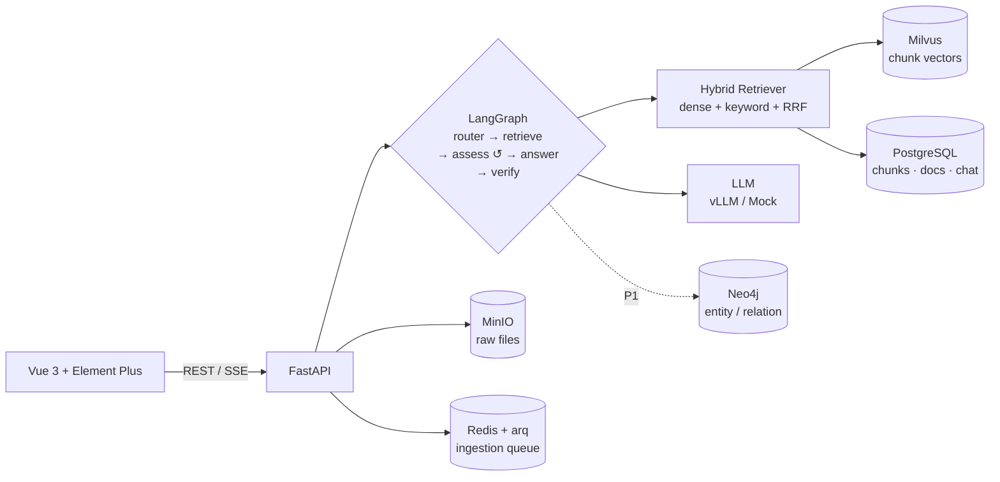

<div align="center">

# LMS 知识中枢

**可私有部署的 RAG + 知识图谱 + 多智能体平台**

[](#-路线图)
[](backend/pyproject.toml)
[](backend/app)
[](backend/app/agents/qa_graph.py)
[](web)
[](docker-compose.yml)
[](backend/tests)

上传文档 → 解析/分块 → 向量化 → 混合检索 → LangGraph 多轮问答 → 引用校验 → 评测

[快速开始](#-快速开始) · [架构](#-架构) · [评测](#-评测) · [路线图](#-路线图) · [FAQ](#-faq)

</div>



> **English**: A self-hosted RAG + knowledge-graph + multi-agent platform. LangGraph orchestrates a bounded retrieve-and-verify loop, Milvus provides dense retrieval, PostgreSQL handles keyword recall and business data, and every answer ships with verifiable citations. Mock mode makes the whole stack runnable offline.

---

## ✨ 特性

- **可验证的引用**：提示词要求每个事实句以 `[n]` 结尾，后端逐条校验编号越界、无引用断言与拒答例外，返回 `verify{ok, issues, citations}`。
- **有界多轮检索**：`router → retrieve → assess ↺ → answer → verify`，按问题词覆盖率判断“资料是否足够”，最多重写检索 2 轮，不会无限循环。
- **混合检索**：Milvus dense + PostgreSQL 关键词（正文与章节标题）+ RRF(k=60) 融合，可选 rerank 重排。
- **全链路可降级**：向量库不可用 → 关键词；rerank 失败 → 跳过；LLM 流中断 → 保留已生成前缀；无证据 → 明确拒答。
- **多租户隔离**：`X-Tenant-Id` 贯穿 PG、Milvus、对象存储 key 与 API 校验，跨租户访问返回 404。
- **异步解析**：`inline`（BackgroundTasks）与 `arq`（Redis 队列）两种任务后端，文档状态 `pending → parsing → chunking → embedding → ready` 可轮询。
- **开箱即用的评测**：4 篇语料、50 道题（含 5 道拒答陷阱），输出 recall / citation / refusal / 延迟分位数。
- **Mock 模式**：未配置模型时使用确定性 Mock LLM + 哈希 Embedding，离线也能跑通上传、检索、问答与测试。

## 🏗 架构



**技术栈**

| 层 | 选型 |
| --- | --- |
| 前端 | Vue 3、Vite 6、Element Plus、Vue Router |
| 后端 | FastAPI、LangGraph 1.x、SQLAlchemy 2（async）、Pydantic Settings |
| 检索 | Milvus 2.5（dense）、PostgreSQL（关键词）、RRF、可选 TEI/vLLM rerank |
| 存储 | PostgreSQL、Redis + arq、MinIO |
| 解析 | pypdf、python-docx、openpyxl、Markdown |
| 图谱（P1） | Neo4j 5 Community、LightRAG 抽取、模板化 Cypher |

## 🚀 快速开始

### 方式一：Docker Compose（推荐）

```bash
git clone <your-repo-url> lms-kgbuild
cd lms-kgbuild
cp .env.example .env
docker compose up -d --build     # 旧版 Docker 用 docker-compose
```

启动后：

- Web UI：<http://127.0.0.1:5173>
- API 文档：<http://127.0.0.1:8100/docs>
- 健康检查：<http://127.0.0.1:8100/api/health>

> 首次启动 Milvus 需要 30–60 秒；端口冲突可在 `.env` 里改 `POSTGRES_PORT` / `REDIS_PORT` / `MINIO_PORT` / `MILVUS_PORT` / `WEB_PORT`。

### 方式二：本地开发

```bash
# 1) 只起基础设施
cp .env.example .env
docker compose up -d postgres redis minio etcd milvus neo4j

# 2) 后端（http://127.0.0.1:8101）
cd backend
uv sync
cp ../.env.example .env          # 按本机端口调整 DATABASE_URL / REDIS_URL
.venv/bin/uvicorn app.main:app --host 0.0.0.0 --port 8101

# 3) 前端（http://127.0.0.1:5173，/api 代理到 8101）
cd ../web
npm install
npm run dev
```

也可以只构建前端，由 FastAPI 直接托管：

```bash
cd web && npm run build          # 产物 web/dist，后端启动时自动挂载
```

### 接入真实模型

平台通过 OpenAI 兼容协议接入 vLLM / TEI；不配置则自动进入 Mock 模式：

```ini
LLM_BASE_URL=http://vllm.internal:8000/v1
LLM_MODEL=Qwen2.5-32B-Instruct
EMBEDDING_BASE_URL=http://vllm.internal:8000/v1
EMBEDDING_MODEL=bge-m3
EMBEDDING_DIM=1024
# 可选
# RERANK_BASE_URL=http://reranker.internal:8002
# VECTOR_BACKEND=milvus
# TASK_BACKEND=arq
```

改完重启 API，`/api/health` 会显示 `llm.mode=openai` 与实际向量库类型。

## ⚙️ 关键配置

完整列表见 [`.env.example`](.env.example)。

| 变量 | 默认值 | 说明 |
| --- | --- | --- |
| `LLM_BASE_URL` / `LLM_MODEL` | 空 | 为空则启用 Mock LLM |
| `EMBEDDING_BASE_URL` / `EMBEDDING_MODEL` | 空 | 为空则启用哈希 Mock Embedding |
| `EMBEDDING_DIM` | `1024` | 需与 embedding 服务输出维度一致 |
| `VECTOR_BACKEND` | `memory` | `memory` / `milvus` |
| `MILVUS_URI` | `http://localhost:19530` | Milvus 连接地址 |
| `TASK_BACKEND` | `inline` | `inline` / `arq`（需同时启动 worker） |
| `CHUNK_SIZE` / `CHUNK_OVERLAP` | `600` / `80` | 字符级分块参数 |
| `RETRIEVAL_TOP_K` / `RERANK_TOP_K` | `20` / `8` | 召回与重排数量 |
| `SUFFICIENCY_THRESHOLD` | `0.35` | 问题词覆盖率阈值，决定是否继续检索 |
| `MAX_RETRIEVAL_ROUNDS` | `2` | 检索轮数上限 |

## 📡 API

所有接口以 `X-Tenant-Id` 区分租户（缺省 `default`）。

| Method | Path | 说明 |
| --- | --- | --- |
| GET | `/api/health` | 模型 / 向量库 / rerank 状态 |
| GET / POST | `/api/kbs` | 知识库列表 / 创建 |
| GET / DELETE | `/api/kbs/{id}` | 详情 / 删除（级联清向量与对象） |
| POST | `/api/kbs/{id}/documents` | 上传文档（pdf/docx/md/txt/xlsx，sha256 去重） |
| GET | `/api/kbs/{id}/documents` | 文档列表与解析进度 |
| GET / DELETE | `/api/documents/{id}` | 文档详情 / 删除 |
| POST | `/api/documents/{id}/reingest` | 重新解析 |
| POST | `/api/search` | 仅检索，返回 `hits / stats / degraded` |
| POST | `/api/chat` | 问答，`stream=false` 返回 JSON，`stream=true` 返回 SSE |
| GET | `/api/conversations/{id}` | 会话消息（含 citations / verify） |

SSE 事件序列：

```text
start → route → retrieve → assess → token* → verify → citations → done
```

异常为 `error`，降级为 `degrade`；`done.data` 含 `answer / citations / verify / route / rounds / stats / conversation_id / message_id`。

## 📊 评测

```bash
# 1) 建库并导入 4 篇语料，等待解析完成
backend/.venv/bin/python eval/run_eval.py --seed

# 2) 用输出的 kb-id 跑 50 题
backend/.venv/bin/python eval/run_eval.py --kb-id <kb-id> --json eval/report.json
```

指标：`recall@k`、`answer_hit`（期望关键词覆盖 ≥50%）、`citation_ok`（`verify.ok`）、`refusal_ok`、`latency p50/p95`。

当前 Mock 模式基线（Milvus 2.5.10 实测）：

| 指标 | 值 |
| --- | --- |
| 通过率 | **50 / 50** |
| recall@8 | 1.00 |
| answer_hit | 1.00 |
| citation_ok | 1.00 |
| refusal_ok | 1.00 |
| p50 / p95 | 25ms / 42ms |
| degraded runs | 0 |

> Mock 结果用于回归与离线演示，不代表真实模型质量。接入 vLLM 后请重新生成 `eval/report.json` 作为基线。

## 🧪 测试

```bash
cd backend
PYTHONPATH=. .venv/bin/pytest -q
.venv/bin/ruff check app tests
```

覆盖结构感知分块（标题/表格/长文）、引用校验（合法/越界/无引用/拒答）、Agent 路由边界、API 全链路（上传 → 索引 → 检索 → 问答 → 会话落库 → SSE 事件序）、租户隔离与去重。

## 📁 目录

```text
backend/
  app/
    api/            FastAPI 路由（kbs / documents / search / chat / health）
    agents/         LangGraph 状态机、提示词、引用校验
    db/             SQLAlchemy 模型与会话
    services/       解析、分块、embedding、llm、retrieval、rerank、ingestion、tasks
    workers/        arq worker
  tests/            18 个用例（分块 / 引用 / 路由 / API+SSE）
  Dockerfile
web/                Vite + Vue 3 + Element Plus
  src/views/        知识库列表、知识库详情、SSE 问答、图谱占位
eval/
  corpus/           4 篇评测语料（差旅 / 采购 / 安全 / 发布）
  golden.jsonl      50 题（45 可答 + 5 拒答）
  run_eval.py       建库、导入、评测与报告
docs/               架构评审、Agent 设计、P0 交付报告
docker-compose.yml  postgres + redis + minio + etcd + milvus + neo4j + api + worker + web
```

## 🧠 设计要点

1. **引用是契约，不是装饰**。回答必须逐句标注来源，后端在流式结束后统一校验；校验失败会出现在 `verify.issues`，而不是静默放过。
2. **检索循环必须有界**。`assess` 同时返回 `sufficient` 与 `round`，路由只认这两个字段；LangGraph 会丢弃未在 `QAState` 声明的键，因此状态字段本身就是协议。
3. **图谱不是银弹**。P0 不把 Neo4j 放进主链路；P1 以 Neo4j 为唯一图存储，LightRAG 只负责抽取，边携带 `source_chunk_ids / doc_ids / confidence`，避免双图谱真相源。
4. **不自由生成 Cypher**。P1 使用参数化模板 + 只读账号 + 超时 + 向量回退，实体链接独立成模块。
5. **评测先行**。拒答题与可答题混排，`refusal_ok` 与 `answer_hit` 同时看，避免“什么都敢答”的模型拿高分。
6. **删除要一致**。删除顺序为向量 → PG → 对象存储；后续 P1 引入 outbox 与对账任务处理失败重试。

## 🗺 路线图

| 阶段 | 内容 | 状态 |
| --- | --- | --- |
| **P0** | 上传/解析/分块/向量化、混合检索、LangGraph 问答、引用校验、SSE、评测、Compose | ✅ 已交付 |
| **P1** | Neo4j 图谱构建（LightRAG 抽取 → 实体对齐 → 模板 Cypher）、G6 子图、完整 hybrid、Langfuse trace | 🚧 设计中 |
| **P2** | MinerU/OCR、MCP 工具接入、子智能体 / DeepAgents、沙盒执行、RBAC 与审计 | 📋 规划 |
| **P3** | 评测平台化、成本与配额、跨租户共享与脱敏 | 📋 规划 |

## ❓ FAQ

<details>
<summary><b>没有 GPU / 没有模型，能跑吗？</b></summary>

能。Mock 模式使用确定性抽取式 LLM 与哈希 Embedding，上传、检索、问答、引用校验、评测全部可离线运行。
</details>

<details>
<summary><b>Milvus 镜像拉取很慢或失败？</b></summary>

可走镜像站后重打 tag：

```bash
docker pull docker.m.daocloud.io/milvusdb/milvus:v2.5.10
docker tag docker.m.daocloud.io/milvusdb/milvus:v2.5.10 milvusdb/milvus:v2.5.10
```
</details>

<details>
<summary><b>上传后文档一直是 pending？</b></summary>

`TASK_BACKEND=arq` 时需要同时启动 worker：

```bash
cd backend
TASK_BACKEND=arq .venv/bin/arq app.workers.worker.WorkerSettings
```

只想单进程运行就保持 `TASK_BACKEND=inline`。
</details>

<details>
<summary><b>pytest 报 <code>No module named 'lark'</code>？</b></summary>

系统里可能装了 ROS 等 pytest 插件，禁用自动加载：

```bash
PYTEST_DISABLE_PLUGIN_AUTOLOAD=1 PYTHONPATH=. .venv/bin/pytest -q -p asyncio
```
</details>

<details>
<summary><b>重启后向量检索不到？</b></summary>

`VECTOR_BACKEND=memory` 是进程内存储，重启即丢失，需要 `reingest`。生产请切 `VECTOR_BACKEND=milvus`（pymilvus 2.6.18 已对 Milvus 2.5.10 实测，写入后重启仍可检索）。
</details>

## 🤝 贡献

欢迎 Issue 与 PR。提交前请确保：

```bash
cd backend
.venv/bin/ruff check app tests
PYTHONPATH=. .venv/bin/pytest -q
```

前端改动请附带 `npm run build` 通过的说明；涉及检索/提示词的改动建议同时贴出 `eval/` 的前后对比。

## 📄 License

[Apache License 2.0](LICENSE) © 2026 1maosheng

---

<div align="center">

如果这个项目对你有帮助，欢迎点一个 ⭐

</div>