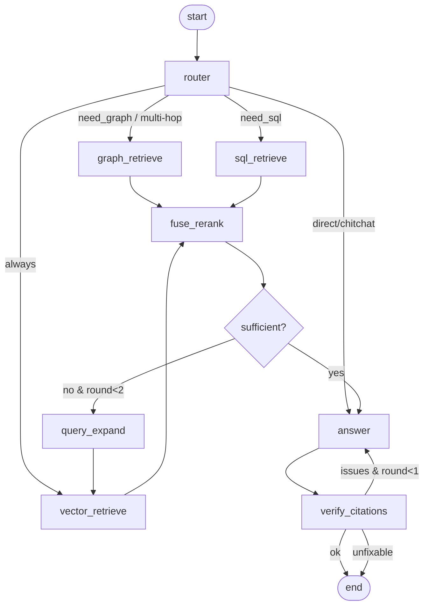

# Agent 设计：LangGraph 编排（v0）

> 配套 `docs/architecture-review.md`。本文只定义**编排层**：状态、节点、路由、工具、降级、可观测。检索/解析细节见后续 `docs/retrieval-design.md`。

## 1. 设计原则

1. **证据优先**：任何结论必须能落到 `chunk_id`；没有证据就回答"不知道"，不编。
2. **每轮有界**：最多 2 轮补检索、最多 1 次图查询重试、总超时 60s（可配）。
3. **按需用图**：图谱是"一个检索通道"，不是必经阶段；简单题不付图查询成本。
4. **可降级**：图库/重排/校验任一失败，退化为纯向量 RAG 并标注降级状态，不整体报错。
5. **成本可见**：每个节点写 token/耗时/命中数，trace 可回放。
6. **内容不可信**：检索片段、工具返回都视为数据，不能直接驱动工具调用。

## 2. 状态定义

```python
from typing import Annotated, Literal, TypedDict
from operator import add

class Evidence(TypedDict):
    chunk_id: str
    doc_id: str
    doc_name: str
    text: str
    score: float
    source: Literal["vector", "graph", "sql", "web"]
    meta: dict          # page, bbox, section, entity_path ...

class Citation(TypedDict):
    claim: str
    chunk_ids: list[str]
    verified: bool

class AgentState(TypedDict, total=False):
    # 输入
    question: str
    tenant_id: str
    kb_ids: list[str]
    user_id: str
    history: list[dict]
    # 路由
    route: dict                 # {intent, complexity, need_graph, need_multi_hop, need_sql}
    plan: list[str]             # 子查询（可选）
    # 检索
    queries: list[str]          # 改写/扩展后的查询
    evidence: Annotated[list[Evidence], add]
    retrieval_round: int
    retrieval_stats: dict       # 各通道耗时/命中
    # 生成
    draft: str
    citations: list[Citation]
    # 校验
    verify: dict                # {ok, issues, missing}
    degrade: list[str]          # ["graph_timeout", "rerank_down"]
    # 观测
    trace_id: str
    node_traces: Annotated[list[dict], add]
    error: str | None
```

要点：

- `evidence` 用 `add` reducer 累加，并行分支天然合并；去重放在 `fuse` 节点做。
- `degrade` 记录降级原因，最终回答 UI 上要能看到"图谱通道不可用"。
- `node_traces` 供 SSE 推送步骤条与 Langfuse 上报。

## 3. 图拓扑



- 并行用 `Send`（map-reduce）实现：router 输出 `queries`，对每个子查询 fan-out 到 vector/graph。
- `interrupt` 只放在两个位置：危险工具审批（P3）、图谱自由的 Cypher 高级模式。
- checkpointer 用 Postgres（与业务库同实例，独立 schema），支持会话恢复与长任务续跑。

## 4. 节点规格

| 节点 | 输入 | 输出 | 逻辑 | 失败处理 |
|---|---|---|---|---|
| `router` | question, history | route, queries | 规则优先（关键词/长度/是否含"对比/为什么/关系"）+ 小模型分类兜底；输出 JSON schema | 分类失败 → 默认走 vector，`degrade+router` |
| `query_expand` | question, round, gaps | queries | 基于缺失点生成 2~3 个子查询（同义/分解/实体补充） | 失败 → 原查询重试一次 |
| `vector_retrieve` | queries, kb_ids, acl | evidence | hybrid：dense + BM25，top-k=20，rerank 到 8 | 超时 → 返回空 + `degrade` |
| `graph_retrieve` | queries, entities | evidence | 实体链接 → 1~2 跳模板查询 → 取 `MENTIONED_IN` 的 chunk；可用 community summary 回答主题题 | 超时/空 → `degrade`，继续向量 |
| `sql_retrieve` | question | evidence | 仅白名单指标表；模板化生成 SQL，只读 | 失败 → `degrade` |
| `fuse_rerank` | evidence[] | evidence[] | 按 chunk 去重、RRF 融合、cross-encoder 重排、按 doc 多样性截断 | rerank 挂 → 用 RRF 分数 |
| `sufficient` | evidence, question | route 决策 | 规则：top1 分数阈值 + 覆盖问题实体数；模型兜底判断"能否回答" | 判不了 → 视为足够，避免死循环 |
| `answer` | evidence, question | draft, citations | 强制输出 `[n]` 引用；无证据时明确拒答 | LLM 失败 → 重试 1 次 → 报错 |
| `verify_citations` | draft, citations, evidence | verify | 规则：每个 `[n]` 必须存在且片段支持关键词；模型只处理争议项 | 校验器挂 → 标记 `unverified` 放行 |

## 5. 路由策略（可解释、可调）

```python
def route_rules(q: str) -> dict:
    need_graph = any(k in q for k in ["关系", "关联", "影响", "对比", "为什么", "链路", "上下游"])
    need_multi_hop = q.count("的") >= 2 or "分别" in q or "各自" in q
    need_sql = any(k in q for k in ["多少", "统计", "占比", "趋势", "排名"])
    simple = len(q) <= 20 and not (need_graph or need_sql)
    return {"need_graph": need_graph, "need_multi_hop": need_multi_hop,
            "need_sql": need_sql, "complexity": "simple" if simple else "complex"}
```

规则覆盖 70%，剩余走小模型（JSON schema 约束）。**路由结果要写进 trace**，方便事后调阈值。

## 6. 检索网关统一接口

```python
@dataclass
class RetrievalRequest:
    query: str
    tenant_id: str
    kb_ids: list[str]
    top_k: int = 20
    filters: dict | None = None   # acl / doc_ids / time range
    mode: Literal["vector", "graph", "sql", "hybrid"] = "hybrid"

@dataclass
class RetrievalResult:
    items: list[Evidence]
    stats: dict                   # latency_ms, candidates, channel
    degraded: str | None
```

三个实现：`MilvusHybridRetriever`、`Neo4jGraphRetriever`、`SqlRetriever`。编排层只依赖接口，换库不改图。

## 7. 融合与重排

1. 各通道结果统一成 `Evidence`，`score` 先做 min-max 归一（按通道）。
2. RRF：`score = Σ 1/(k + rank_i)`，k=60。
3. 按 `chunk_id` 去重，保留最高分与来源集合。
4. cross-encoder（bge-reranker-v2-m3）重排 top-30 → top-8。
5. 按文档多样性截断（同一 doc 最多 3 条），避免一份文档淹没上下文。

## 8. 充分性与补检索

- 规则：`top1_score >= τ` 且 覆盖问题中至少 1 个实体/关键词 → 足够。
- 不够：`query_expand` 生成补充查询，**换通道**（向量不够 → 试图谱；图谱空 → 试全文），最多 2 轮。
- 仍不够：回答中明确"知识库中未找到直接依据"，并给出最接近的片段（不编造）。

## 9. 生成契约（Citation Contract）

系统提示必须包含：

- 只能使用给定 `[n]` 片段；每个事实句末尾标 `[n]`；
- 不得合并编号、不得引用不存在的编号；
- 证据不足时输出固定句式 `根据现有资料无法确定……`；
- 表格/公式类证据单独标注来源页码。

校验（规则优先）：

```python
def check(draft, citations, evidence):
    cited = set(re.findall(r"\[(\d+)\]", draft))
    issues = []
    if not cited and "无法确定" not in draft:
        issues.append("no_citation")
    for c in cited:
        if int(c) not in range(1, len(evidence) + 1):
            issues.append(f"bad_ref:{c}")
    # 关键词覆盖：claim 中的名词是否出现在对应片段（粗校验）
    ...
    return issues
```

模型校验只对"疑似不支持"的 claim 做二次判断，控制成本。

## 10. 工具与权限（P3 落地）

| 工具 | 风险级 | 约束 |
|---|---|---|
| `search_knowledge` | read | 强制 tenant/kb 过滤 |
| `graph_query` | read | 模板 + 只读账号 + 超时 |
| `sql_query` | read | 白名单表 + 行数上限 |
| `web_search` | read | 默认关闭；内容不可信标记 |
| `write_file` / `run_code` | write/dangerous | 沙箱 + 审批 + 审计 |
| MCP 外部工具 | 按注册表 | allowlist + 参数 schema 校验 + 超时 |

工具调用统一走 `ToolGateway`：权限检查 → 参数校验 → 执行 → 审计 → 结果脱敏。

## 11. 横切（中间件）

- **上下文预算**：按 token 截断历史与证据，优先保留高分段与被引用段。
- **PII/脱敏**：输出前按租户策略过滤。
- **限流**：按 tenant/user 的 QPS 与 token 配额。
- **审计**：每次 run 落 `run_trace` + `audit_log`（谁、问了什么、用了哪些工具、看了哪些文档）。
- **可观测**：Langfuse callback + 本地 `node_traces` 双写；SSE 事件类型：`route / retrieve / fuse / answer_delta / citation / verify / done / error`。

## 12. 降级矩阵

| 故障 | 行为 | 用户可见 |
|---|---|---|
| Neo4j 超时/宕机 | 跳过图通道，纯向量 | "图谱通道暂不可用" |
| reranker 不可用 | 用 RRF 分数 | 无感（trace 标注） |
| LLM 超时 | 重试 1 次，换备用模型 | 可能更慢 |
| 全部检索为空 | 拒答 + 建议 | 明确"未找到依据" |
| 校验失败且不可修 | 输出但标 `unverified` | 引用旁标"未校验" |

## 13. Trace 字段（最小集）

```json
{
  "trace_id": "...", "tenant_id": "...", "question": "...",
  "route": {"need_graph": true, "complexity": "complex"},
  "nodes": [{"name": "vector_retrieve", "ms": 320, "hits": 18, "tokens": 0}],
  "evidence": [{"chunk_id": "...", "source": "graph", "score": 0.82}],
  "llm": {"model": "...", "prompt_tokens": 0, "completion_tokens": 0},
  "degrade": [], "verify": {"ok": true, "issues": []},
  "total_ms": 4200
}
```

## 14. 与 DeepAgents 的边界

- **不要**把主问答链做成 DeepAgents 的开放循环：不可控、成本高、难评测。
- DeepAgents 只用于两类场景：① 长任务/多文件产出（报告生成、批量整理）；② 需要 todo 清单与文件读写的"工作台"模式。
- 两者共用 `ToolGateway` 与权限层；DeepAgents 的沙箱必须是真的隔离环境。

## 15. 实施顺序

1. `RetrievalGateway` 接口 + 纯向量实现 + 评测脚本（不依赖图）。
2. `router` + `fuse` + `answer` + `verify` 最小闭环（LangGraph）。
3. 接 `graph_retrieve`，用 golden set 做 A/B（开/关图通道）。
4. 加 SSE、trace、降级、HITL。
5. 最后才接 MCP / 沙箱 / DeepAgents。