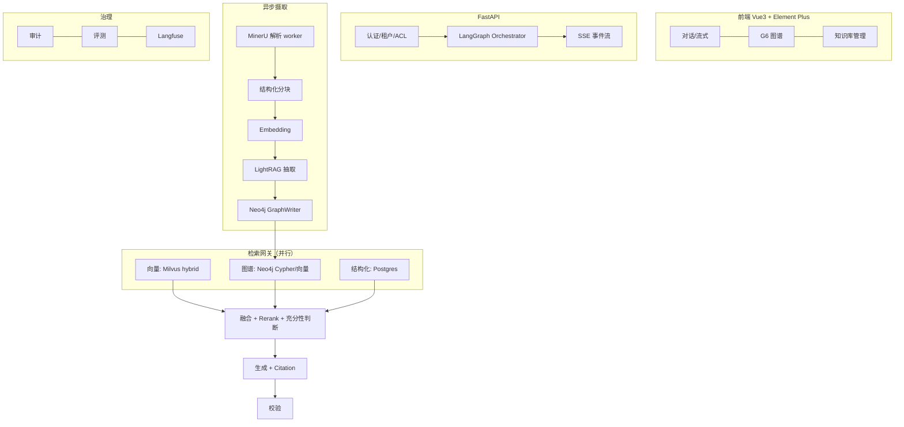

# 架构评审：RAG + 知识图谱 + 多智能体平台

> 评审时间：2026-11-18 · 评审对象：当前 `lms-kgbuild` 方案稿
> 结论先行：方向对（私有化 + 图谱增强 + 可解释 + Agent 编排），但**现在直接开工会返工**。有 4 个结构性问题必须先定，3 个选型要改，范围要砍到一条垂直切片。

---

## 0. 总体判断

| 维度 | 评分 | 判断 |
|---|---|---|
| 产品定位 | B+ | "私有化 + 可解释问答"成立，比纯 RAG 有差异化 |
| 架构完整性 | B | 层次齐，但**数据流**（谁写图谱、谁读图谱）没定义 |
| 可落地性 | C+ | 范围过大；本机无 GPU、磁盘紧，全栈同时起不来 |
| 风险控制 | C | 没有评测基线、没有删除一致性方案、没有权限落点 |

**一句话**：这不是"多写一个 Agent"的问题，而是先把**图的真相源、检索的融合方式、评测基线**三件事钉死，再写编排。否则 Agent 写得再漂亮，也只是把两个互不对齐的检索器串起来。

---

## 1. 四个必须现在定的结构性问题（P0）

### 1.1 双图谱真相源冲突 —— 最严重

方案同时写了：

- "LightRAG 自动从文档抽取实体/关系建图"
- "Neo4j 存储实体/关系，支持自动构建、手动导入、Cypher 查询"

但**没有定义两者是什么关系**。LightRAG 自己就有 graph storage（默认 NetworkX，也支持 Neo4j），如果让它抽完写自己的图、再单独写一套 Neo4j，必然出现：

- 同一实体两套 ID、命名不统一（"苹果公司" / "Apple Inc." / "苹果"）
- 边重复、权重口径不一致
- 删除文档时一边删了、另一边没删
- 回答里的 citation 无法回溯到 chunk（因为边没有 provenance）

**三种收口方式，选一个：**

| 方案 | 做法 | 优点 | 代价 |
|---|---|---|---|
| **A（推荐）** | Neo4j 是唯一图存储；LightRAG 只当"抽取流水线"（实体/关系抽取 + gleaning + 社区摘要），通过自定义 GraphStorage 写入 Neo4j | 可解释、可运维、schema 自主 | 要写 Neo4j 适配层，LightRAG 查询模式需改造 |
| B | 双层图：文档图（LightRAG 内部，可重建）+ 领域图（Neo4j，人工/规则维护） | 职责清晰 | 必须做实体对齐（alias + 向量相似度阈值），复杂度不低 |
| C | 直接用 LightRAG 的 Neo4j backend | 最省事 | schema 被 LightRAG 锁死，业务扩展受限，升级易崩 |

无论选哪个，**边必须带 provenance**：`source_chunk_ids`、`doc_ids`、`confidence`、`extractor_version`。没有这个，"可解释"就是一句口号。

> 补充：社区摘要（community summary）是回答"整体性/主题性"问题的关键，LightRAG 的 global 模式就靠它。如果要保留 global 查询，必须在 Neo4j 里持久化 community 层级，而不是每次查询现算。

### 1.2 "Neo4j 做推理"被高估：LLM 生成 Cypher 不可靠

Cypher 由 LLM 自由生成的风险是实打实的：

- schema 幻觉（表/关系名编造）
- 提示注入（文档正文里藏 Cypher 片段）
- 慢查询拖垮库（无 LIMIT 的笛卡尔积）
- 结果不可复现，没法评测

**修正：**

1. schema 注入 + few-shot 模板 + **受限 DSL**（多跳模板、聚合模板、对比模板），自由 Cypher 只作为"高级模式"且需人工确认（LangGraph `interrupt`）。
2. 只读账号 + 语句白名单 + 超时（`dbms.transaction.timeout`）+ 结果行数上限 + 并发隔离。
3. 失败**必须**回退到向量检索，不能把图查询当唯一通路。
4. **实体链接单独成模块**：alias 索引 + 向量召回 + 阈值 + 歧义澄清（"你说的苹果是公司还是水果"）。多跳问答的瓶颈通常在这里，不在 Cypher。

### 1.3 固定五段流水线 ≠ 多智能体

"检索 → 图谱推理 → 分析 → 生成 → 复核" 作为**固定串行图**有三个问题：

- 简单事实题也要 5 次 LLM 调用，延迟和成本翻倍；
- "复核"节点没有证据约束，本质是 LLM 自评，容易橡皮图章；
- 图谱通道对"这份文档讲了什么"这类问题毫无增益，却每次都被调用。

**修正为条件路由 + 并行 + 有界循环：**

```
Query
  → Router（意图/复杂度/是否需要图谱/是否需要多跳）
  → 并行 fan-out：vector / graph / structured(SQL) / （可选）web
  → Fusion + Rerank（按证据去重、打分）
  → Sufficiency check（证据够不够？不够 → 有界补检索 ≤2 轮）
  → Answer（强制 citation）
  → Verify（claim → evidence 对齐，规则优先，模型兜底）
  → 输出（附引用 + 置信度 + 用到的通道）
```

实现上用 LangGraph 的 `Send` API 做并行分支、conditional edges 做路由、checkpointer 做中断恢复（HITL 审批、长任务续跑）。**每个节点都要能在 trace 里看到输入/输出/耗时/token**，否则调不动。

### 1.4 权限与多租户必须在数据模型第一行，不能检索后过滤

私有化部署的卖点就是"数据不出域 + 权限可控"。检索后过滤 = 越权内容已经进了上下文，等于泄露。

- **Milvus**：partition（按 KB/租户）+ filter expr（doc_id/acl），而不是查完再筛；
- **Neo4j**：所有节点/边带 `tenant_id`，查询构造器强制注入，禁止裸 Cypher 绕过；
- **Postgres**：RLS 或统一 repository 层强制 `tenant_id`；
- **MCP/工具**：分级（read / write / dangerous）、allowlist、危险操作走审批、全量审计日志；
- **提示注入**：检索到的文档内容一律按**不可信数据**处理——不能让它直接触发工具调用；工具参数要过策略引擎。

### 1.5 删除/更新一致性（最容易被忽略，上线必炸）

删一份文档要级联：chunk → 向量 → 图节点/边 → 社区摘要 → 缓存 → 进行中的任务。

建议：**软删除 + outbox 事件 + 定期对账 GC**；chunk 级 `chunk_hash` 去重；`doc_version` 支持重解析而不产生重复图谱。删除接口要能返回"删了多少向量/节点/边"，并有一致性检查任务。

---

## 2. 选型修正（逐项）

| 项 | 方案现状 | 问题 | 建议 |
|---|---|---|---|
| 向量库 | Milvus（本机是 `v3.0-beta`） | beta 版，API/生态未稳，LightRAG/pymilvus 适配未必跟齐 | **2.5.x LTS**，standalone + etcd + MinIO；本机镜像需重拉 |
| 检索方式 | 纯 dense 向量 | 标准号、型号、专有名词、否定句召回差 | **hybrid**：dense(bge-m3) + BM25/sparse + **bge-reranker-v2-m3** 重排；Milvus 2.5 原生全文检索可用 |
| 文档解析 | "MinerU + PP-Structure-V3" | **两套解析栈重叠**（MinerU 2.x 自带版面/公式/表格；PP-StructureV3 属 PaddleOCR 3.x），依赖两套框架、坐标体系难对齐 | **二选一**。优先 MinerU 2.x pipeline 后端；扫描件/复杂表格再评估 PP-StructureV3，不要串在一个流程里 |
| 解析执行 | 未提 | 解析是长任务、GPU 密集，阻塞 API 会拖死服务 | Redis 队列 + worker（ARQ/Celery），进度回传、失败重试、超时；表格/公式单独 chunk 类型并保留 HTML/LaTeX |
| 图库 | Neo4j | 社区版**单库、无 RBAC、无集群**；多租户只能靠 label/property + 应用层强制 | 社区版 + 应用层网关即可；需要行级权限再上企业版。**本机没有 neo4j 镜像，需拉取** |
| 编排 | "LangGraph v1 + create_agent" | `create_agent` 属 LangChain 1.x（建在 LangGraph 上），与 LangGraph 原生 API 混用；1.x 迭代快 | 锁版本 + **薄适配层**（别在业务代码里到处 import）；Python 3.11/3.12；`uv lock` |
| 子智能体/长任务 | DeepAgents | 其文件系统/代码执行需要真沙箱，否则只是"伪隔离" | 沙箱独立服务：docker + 无网络 + 只读根 + seccomp + 资源限额，gVisor 可选 |
| 前端图谱 | AntV G6 | 万级节点全量渲染会卡 | G6 v5 WebGL + 子图按需加载 + 采样 + 聚焦展开；SSE 流式展示 agent 步骤 |
| 可观测 | 未提 | 无法定位"为什么答错" | Langfuse（本机已有源码）+ 每次 run 记录检索命中/工具调用/token/耗时 |
| 评测 | 未提 | 无法证明"图谱优于纯 RAG"，也无法防回归 | **先建 50~100 题 golden set**（多跳/对比/否定/表格/无答案），CI 跑 recall@k、citation 准确率、延迟、成本 |

---

## 3. 修正后的目标架构



**关键数据流（必须写进设计文档）：**

1. 上传 → MinIO 原文件 → 解析任务（队列）→ 结构化 chunk（带 page/bbox/表格/公式类型）→ Postgres 落 chunk 元数据 + Milvus 写向量；
2. 同一批 chunk → 抽取 → 实体规范化（alias + 向量聚类）→ Neo4j 写 Entity/REL + `MENTIONED_IN` 指向 chunk；
3. 查询 → Router → 并行检索 → 融合重排 → 生成 → 校验 → SSE 回传（含引用片段与通道标记）。

---

## 4. 数据模型草案

**Postgres（业务/治理）**

```
tenant(id, name, quota...)
user(id, tenant_id, ...)
kb(id, tenant_id, name, embedding_model, config_json)
document(id, kb_id, tenant_id, name, hash, version, status, acl_json, ...)
chunk(id, doc_id, kb_id, seq, type(text/table/formula/image), text, meta_json, chunk_hash)
ingestion_task(id, doc_id, stage, status, error, progress)
conversation / message / run_trace(id, trace_json, tokens, cost, latency)
audit_log(id, tenant_id, user_id, action, target, detail, ts)
entity_alias(tenant_id, kb_id, alias, entity_id, source)
eval_case / eval_result
```

**Neo4j（图）**

```
(:Entity {id, name, canonical_name, type, tenant_id, kb_id, embedding, aliases[]})
(:Chunk  {id, doc_id, tenant_id, kb_id})
(:Community {id, level, summary, tenant_id, kb_id})
(:Entity)-[:REL {type, weight, confidence, source_chunk_ids[], doc_ids[], extractor_version}]->(:Entity)
(:Entity)-[:MENTIONED_IN]->(:Chunk)
```

索引：`Entity.name`、`Entity.aliases`、`tenant_id`；Entity.embedding 向量索引（Neo4j 5.11+）；chunk 全文索引用于实体链接兜底。

---

## 5. 分期与验收（按"可演示、可度量"切）

| 阶段 | 内容 | 验收标准 |
|---|---|---|
| **P0 基座**（约 1 周） | compose 一键起；上传→解析→分块→向量化→纯 RAG 问答（带引用）；评测集 v0 | 50 题 golden set 跑通；recall@5 ≥ 0.8；每个引用可点开原文定位 |
| **P1 图谱**（1~2 周） | LightRAG 抽取 → Neo4j；实体链接；local/global 检索；删除一致性 | 多跳题准确率相对 P0 **+15pt**；建图成本/文档可度量；删文档后图/向量零残留 |
| **P2 Agent**（1~2 周） | Router + 并行 + 融合 + 校验 + 有界补检索 + SSE + HITL | 简单题不触发图谱通道；P95 延迟达标；trace 可回放 |
| **P3 平台化** | MCP / 子智能体 / 沙箱 / 权限治理 / 图谱可视化 / 多租户 | 越权用例 0 通过；危险工具需审批；审计可查 |

**先做单 KB 端到端垂直切片**，再横向加多租户和权限。不要一开始就铺满 8 个基础设施组件。

---

## 6. 本机环境的现实约束（会影响落地方式）

| 项 | 现状 | 影响 |
|---|---|---|
| GPU | **无**（`nvidia-smi` 不存在） | 本地跑不了 vLLM/MinerU-GPU；LLM 必须走 API 或远程 GPU |
| 内存 | 23G（可用约 8G） | Milvus + Neo4j + ES + MinerU 不能同时起，需 profile |
| 磁盘 | `/home` 仅剩 14G；`/media/david/Software` 剩 327G；`/var/lib/docker` 剩 21G | docker 数据目录应迁到大盘；镜像要精简 |
| 网络 | GitHub 不通；PyPI(清华)、DeepSeek、npmmirror 可达 | 依赖走国内源；代码不能指望 clone GitHub |
| 已有镜像 | Milvus 3.0-beta、etcd、MinIO、Postgres、ES、HugeGraph、Redis | 缺 **Neo4j**，需从国内镜像拉；Milvus 需降级到 2.5 |
| 已有服务 | Dify(80)、Adminer(8080)、Redis(6379)、一个 8000/5173 的测试平台 | 端口要规划，避免冲突 |

**建议**：LLM 用 DeepSeek/通义 API（开发期），交付时给 vLLM 部署清单；embedding/rerank 用 API 或 CPU 版 bge（慢但能跑）；MinerU 用 CPU 模式（慢，仅开发验证），生产放 GPU 机器。

---

## 7. 风险登记

| # | 风险 | 概率 | 影响 | 缓解 |
|---|---|---|---|---|
| R1 | 图谱抽取质量差（小模型/中文/表格） | 高 | 高 | 抽取用强模型或蒸馏；表格单独处理；抽检 + 人工修正入口 |
| R2 | 双图不同步 | 高 | 高 | 按 1.1 收口 + 对账任务 |
| R3 | Cypher 注入/慢查询 | 中 | 高 | 只读 + 模板 + 白名单 + 超时 |
| R4 | 解析长任务拖垮服务 | 高 | 中 | 队列 + worker + 超时 |
| R5 | 版本漂移（LangChain 1.x） | 中 | 中 | 锁版本 + 适配层 |
| R6 | 无评测，无法证明价值 | 高 | 高 | P0 就建 golden set |
| R7 | 磁盘/内存不足导致演示失败 | 高 | 中 | 资源 profile + 数据目录迁移 |
| R8 | 提示注入导致工具滥用 | 中 | 高 | 内容不可信 + 策略引擎 + 审批 |

---

## 8. 建议的下一步（按顺序）

1. **确认 4 个决策**（见对话中的选择项）：代码基线、模型接入、首期范围、图库。
2. 冻结 `docs/agent-design.md`（状态机、节点、工具、降级矩阵）。
3. 起 P0 骨架：compose（pg/redis/minio/milvus/neo4j）+ FastAPI + 上传/解析/检索 + 评测脚本。
4. 用 3~5 份真实文档跑通"上传→问答→引用"，再谈图谱。

> 评审的底线判断：**这个平台的价值不在"用了 LangGraph/Neo4j"，而在"答案可追溯、权限不越界、效果可度量"**。这三点守不住，技术栈再新也只是 demo。